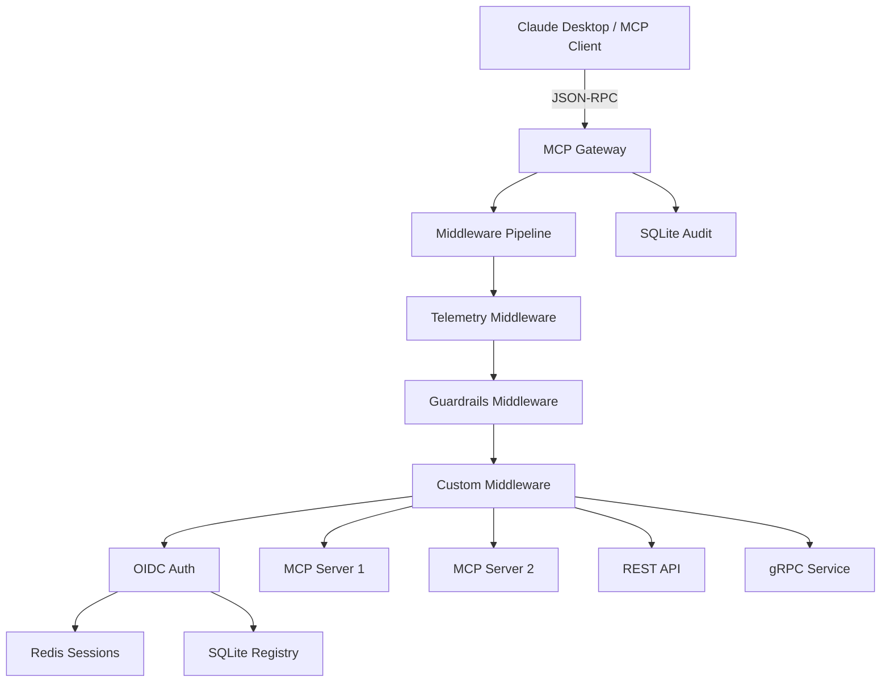

# Secure MCP Middleware Gateway

An authenticated entry point for MCP servers and legacy APIs. The gateway maintains a registry, filters tool discovery and execution by role, routes MCP sessions through Redis, and records execution audit fingerprints. It also virtualizes REST and gRPC APIs as MCP tools and applies deterministic DLP redaction to request and response payloads.

## Features

- **Pluggable Middleware Pipeline:** Extensible interceptor pattern with beforeRequest, afterResponse, and onError hooks for custom logic.
- **Guardrails & Tool-Call Interceptor:** Blocklist/allowlist for tool names, pattern matching for destructive commands (e.g., `rm -rf`, `sudo`), and protected path detection.
- **Output Truncation:** Automatic truncation of oversized responses with configurable size limits to prevent context overflow.
- **Lightweight Telemetry:** Logs tool execution latency, method names, and packet byte sizes to stderr or configurable logger.
- **DLP at the gateway boundary:** scans JSON arguments, returned values, and SSE event data. It redacts common credentials and private keys, email addresses, phone numbers, SSNs, payment card numbers, sensitive-key values, and organization-defined phrases or regex patterns. Redacted request arguments are forwarded to the backend; sanitized payloads are used for audit records.
- **gRPC reflection adapter:** discovers unary methods from a reflection-enabled gRPC service and exposes them as MCP tools. TLS is enabled by default. Streaming RPC methods are currently skipped.
- **OpenAPI REST adapter:** imports supported operations from an OpenAPI 3.x document and builds schema-validated MCP tool definitions.
- **Gateway federation and peer links:** discovers and routes tools from remote MCP registries and separately administered gateways. Imported tools are namespaced and access is mapped to local roles.
- **OIDC, RBAC, Redis session affinity, SSE, WebSockets, OTLP, and Splunk HEC audit delivery.**

DLP uses deterministic patterns rather than an NER model. It cannot guarantee detection of unknown sensitive data; configure and evaluate organization-specific patterns before use with sensitive workloads.

## Architecture



**Request Flow:**
1. Client sends JSON-RPC request to Gateway
2. Request passes through Middleware Pipeline (Telemetry → Guardrails → Custom)
3. Guardrails check tool names, arguments, and patterns
4. Auth validates OIDC token and RBAC roles
5. Request forwarded to appropriate backend (MCP, REST, gRPC)
6. Response passes back through pipeline (Custom → Guardrails → Telemetry)
7. Guardrails truncate oversized responses
8. Telemetry logs latency and metrics
9. Audit record written to SQLite

## Quickstart

```bash
# Install dependencies
python -m venv .venv
. .venv/bin/activate
pip install -r requirements.txt

# Configure minimal settings (for local development)
export MCP_ALLOW_IN_MEMORY_SESSIONS=true
export MCP_GATEWAY_HOST=127.0.0.1
export MCP_GATEWAY_PORT=8080

# Run the gateway
python main.py
```

The gateway will start on `http://127.0.0.1:8080` with middleware pipeline enabled (Telemetry + Guardrails).

## Run locally

Requires Python 3.10 or newer and Redis. Install the dependencies and configure the IdP:

```sh
python -m venv .venv
. .venv/bin/activate
pip install -r requirements.txt

export MCP_OIDC_ISSUER="https://identity.example/"
export MCP_OIDC_AUDIENCE="mcp-gateway"
export MCP_OIDC_JWKS_URI="https://identity.example/.well-known/jwks.json"
export MCP_ROLE_MAP='{"mcp.admin":["Gateway-Admins"],"mcp.engineer":["Engineering"]}'
export MCP_REDIS_URL="redis://localhost:6379/0"

# Optional: Configure guardrails
export MCP_BLOCKED_TOOLS='["dangerous_tool", "delete_database"]'
export MCP_BLOCKED_PATTERNS='["rm -rf", "sudo ", "docker rm", "kubectl delete"]'
export MCP_PROTECTED_PATHS='["/etc", "/usr", "/var", "/home", "/root"]'
export MCP_MAX_RESPONSE_SIZE="2097152"  # 2MB

python main.py
```

The gateway listens on `127.0.0.1:8080` by default. Authenticated routes require an RS256 or ES256 bearer token with `exp`, `sub`, `iss`, and `aud` claims. Roles may be read from `roles`, `groups`, or Keycloak's `realm_access.roles`; `MCP_ROLE_MAP` maps IdP group names to gateway roles. `mcp.admin` is required to register or remove tools. `mcp.engineer` is the default role for discovery and execution when registering a tool.

For single-process local development only, `MCP_ALLOW_IN_MEMORY_SESSIONS=true` allows the gateway to run without Redis. Do not use this setting for deployment.

## Routes

| Route | Purpose |
| --- | --- |
| `POST /mcp` | MCP Streamable HTTP / JSON-RPC endpoint; handles initialize, tools/list, and tools/call. SSE responses are streamed with configurable keepalives. |
| `POST /tools`, `GET /tools`, `DELETE /tools/{name}` | Register, discover, and remove MCP tools; discovery and calls are filtered by read/write roles. |
| `POST /adapters/openapi` | Import supported operations from an OpenAPI 3.x specification. |
| `POST /adapters/grpc` | Discover unary methods from a gRPC reflection-enabled service. |
| `POST /federations`, `POST /federations/{name}/sync` | Register or refresh an upstream MCP registry. |
| `POST /peers`, `POST /peers/{name}/sync`, `GET /peers`, `DELETE /peers/{name}` | Manage an authenticated peer gateway link. Peer calls use a configured bearer credential and local role mapping. |
| `GET /sse/{name}`, `GET /ws/{name}` | Proxy an explicitly registered SSE or WebSocket adapter. |
| `GET /health` | Basic process health endpoint. It does not verify downstream dependencies. |

Tool registration and adapter examples are admin-only. A standard tool registration looks like:

```json
{
  "name": "echo",
  "endpoint": "http://mcp-server:9000/mcp",
  "transport": "streamable-http",
  "read_roles": ["mcp.engineer"],
  "write_roles": ["mcp.engineer"],
  "tool": {
    "description": "Echo text",
    "inputSchema": {
      "type": "object",
      "properties": {"text": {"type": "string"}},
      "required": ["text"]
    }
  }
}
```

For OpenAPI, submit `{ "name", "base_url", "spec", "read_roles", "write_roles" }` to `/adapters/openapi`. The spec must be OpenAPI 3.x JSON; local component references are supported. For gRPC, submit `{ "name", "target", "tls", "read_roles", "write_roles" }` to `/adapters/grpc`. Reflection must be enabled on the service. Credentials are referenced by environment variable names and should be supplied through a secret manager.

For a peer link, submit `{ "name", "registry_url", "mcp_url", "credential_env", "read_roles", "write_roles" }` to `/peers`. The environment variable contains a pre-provisioned bearer token accepted by the remote gateway. Configure the reciprocal link separately at the partner. Token refresh and automatic trust negotiation are not implemented.

## DLP configuration

The built-in scanner redacts common API tokens, bearer credentials, private keys, email addresses, phone numbers, SSNs, valid Luhn payment card numbers, and values under sensitive-looking JSON keys. Add organization-specific rules with:

```sh
export MCP_DLP_SECRET_PHRASES='["internal project phrase"]'
export MCP_DLP_CUSTOM_PATTERNS='{"EMPLOYEE_ID":"\\bEMP-[0-9]{6}\\b"}'
```

`MCP_DLP_SECRET_PHRASES` and `MCP_DLP_CUSTOM_PATTERNS` are JSON values. Custom patterns are regular expressions. Review these rules against legitimate tool inputs because redaction may change values expected by a backend.

## Audit and telemetry

Each tool-call verdict is stored in SQLite with canonicalized payload JSON, its SHA-256, a unique execution identifier, and an execution fingerprint. The fingerprint and verdict are also attached to an OpenTelemetry span. To export telemetry, set `OTEL_EXPORTER_OTLP_ENDPOINT` and standard `OTEL_EXPORTER_OTLP_*` options. For Splunk HEC delivery, set `MCP_AUDIT_WEBHOOK_URL` and `MCP_SPLUNK_HEC_TOKEN`; pending events are retried from a SQLite outbox.

A SHA-256 fingerprint provides tamper evidence but is not a digital signature or proof of immutability. Protect the database and configure access control and retention in the centralized log backend.

## Kubernetes staging

The provided `deploy/k8s/staging.yaml` deploys the gateway and Redis as StatefulSets with persistent volumes, readiness/liveness probes, and headless services. The gateway starts with one replica because registry and audit writes use local SQLite. Redis provides shared session state; it does not make SQLite a multi-writer database.

1. Edit the `gateway-config` ConfigMap values in `deploy/k8s/staging.yaml` for the cluster's IdP and role mapping.
2. Build and publish the container image, changing the manifest image reference if needed:

   ```sh
   docker build -t secure-mcp-gateway:staging .
   # Tag and push to a registry accessible to your Kubernetes cluster.
   ```

3. Optionally create a Kubernetes Secret named `gateway-secrets` for Splunk settings and outbound peer/API credential environment variables. Do not commit real tokens:

   ```sh
   kubectl -n secure-mcp create secret generic gateway-secrets \
     --from-literal=MCP_SPLUNK_HEC_TOKEN='...' \
     --from-literal=REMOTE_PEER_TOKEN='...'
   ```

4. Apply the staging resources:

   ```sh
   kubectl apply -f deploy/k8s/staging.yaml
   kubectl -n secure-mcp get pods,svc,pvc
   ```

The gateway pod imports optional keys from `gateway-secrets` as environment variables, so adapter and peer registrations can refer to those names. Configure `MCP_AUDIT_WEBHOOK_URL` and `OTEL_EXPORTER_OTLP_ENDPOINT` there as needed. This staging manifest uses Redis without authentication and is not a production security profile. Before production, configure Redis TLS/auth, network policies, a secret manager, an OTLP collector, backups, and a shared transactional registry/audit database before scaling gateway replicas.

## Configuration reference

| Variable | Purpose |
| --- | --- |
| `MCP_GATEWAY_HOST`, `MCP_GATEWAY_PORT` | Bind address and port. |
| `MCP_GATEWAY_DB`, `MCP_GATEWAY_AUDIT` | SQLite registry/audit database and JSONL audit file. |
| `MCP_REDIS_URL`, `MCP_SESSION_TTL_SECONDS` | Required distributed session store and session lifetime. |
| `MCP_ALLOW_IN_MEMORY_SESSIONS` | Local development fallback; leave unset in deployment. |
| `MCP_OIDC_ISSUER`, `MCP_OIDC_AUDIENCE`, `MCP_OIDC_JWKS_URI` | OIDC access-token validation. |
| `MCP_ROLE_MAP` | Map IdP groups to gateway roles. |
| `MCP_SSE_KEEPALIVE_SECONDS` | SSE keepalive interval. |
| `MCP_DLP_SECRET_PHRASES`, `MCP_DLP_CUSTOM_PATTERNS` | Extra DLP phrases and regex rules. |
| `OTEL_EXPORTER_OTLP_ENDPOINT`, `OTEL_SERVICE_NAME` | OTLP export endpoint and service identity. |
| `MCP_AUDIT_WEBHOOK_URL`, `MCP_SPLUNK_HEC_TOKEN` | Splunk HEC audit delivery. |
| `MCP_BLOCKED_TOOLS` | JSON array of tool names to block (guardrails). |
| `MCP_ALLOWED_TOOLS` | JSON array of allowed tool names (if set, blocks all others). |
| `MCP_BLOCKED_PATTERNS` | JSON array of regex patterns to block in tool arguments. |
| `MCP_PROTECTED_PATHS` | JSON array of filesystem paths to protect from tool access. |
| `MCP_MAX_RESPONSE_SIZE` | Maximum response size in bytes before truncation (default: 2MB). |
| `MCP_MAX_TOKENS` | Optional token limit for response truncation (experimental). |

## Custom Middleware

To add custom middleware, create a class implementing the `Middleware` interface:

```python
from pipeline import Middleware, RequestContext, ResponseContext, ErrorContext
from pipeline import get_pipeline

class MyCustomMiddleware(Middleware):
    async def before_request(self, request, context):
        # Modify or reject request
        if "restricted" in request.get("method", ""):
            return None  # Reject
        return request

    async def after_response(self, response, context):
        # Modify response
        return response

    async def on_error(self, error, context):
        # Handle errors
        return None

# Register in main.py startup
pipeline = get_pipeline()
pipeline.use(MyCustomMiddleware())
```

## Claude Desktop Configuration

Example configuration for connecting Claude Desktop to the gateway (see `claude_desktop_config.json`):

```json
{
  "mcpServers": {
    "secure-gateway": {
      "command": "python",
      "args": ["/path/to/mcpmiddleware/main.py"],
      "env": {
        "MCP_GATEWAY_HOST": "127.0.0.1",
        "MCP_GATEWAY_PORT": "8080",
        "MCP_ALLOW_IN_MEMORY_SESSIONS": "true",
        "MCP_BLOCKED_TOOLS": "[\"dangerous_tool\", \"delete_database\"]",
        "MCP_BLOCKED_PATTERNS": "[\"rm -rf\", \"sudo \", \"docker rm\", \"kubectl delete\"]",
        "MCP_PROTECTED_PATHS": "[\"/etc\", \"/usr\", \"/var\", \"/home\", \"/root\"]",
        "MCP_MAX_RESPONSE_SIZE": "2097152"
      }
    }
  }
}
```

Place this in your Claude Desktop settings (`~/.config/Claude/claude_desktop_config.json` on Linux/Mac or `%APPDATA%\Claude\claude_desktop_config.json` on Windows), updating the path to point to your installation.

## Integration smoke check

The optional end-to-end harness starts a reference MCP server plus local REST, gRPC reflection, federation, SSE/WebSocket, OTLP, and HEC test services. Install the MCP SDK and run:

```sh
pip install 'mcp[cli]'
python work/e2e.py
```

The harness uses an explicit in-memory session setting and local mock credentials. It is for development verification; it does not validate a live Redis service, Kubernetes cluster, production IdP, or external telemetry backend.

## Security notes

- Restrict outbound network access for REST and gRPC adapters; administrator-supplied endpoints are an SSRF boundary.
- Use TLS at the ingress and configure upstream TLS/authentication appropriately.
- Regex DLP and prompt-pattern checks are defense-in-depth. They do not replace backend authorization, isolation, or human review for sensitive actions.
- Federation uses pre-provisioned bearer tokens. Store and rotate credentials outside the registry database.
- SQLite and a local audit file are single-instance stores. Centralized delivery retries are also backed by SQLite; deploy a shared durable store before horizontally scaling the gateway.
